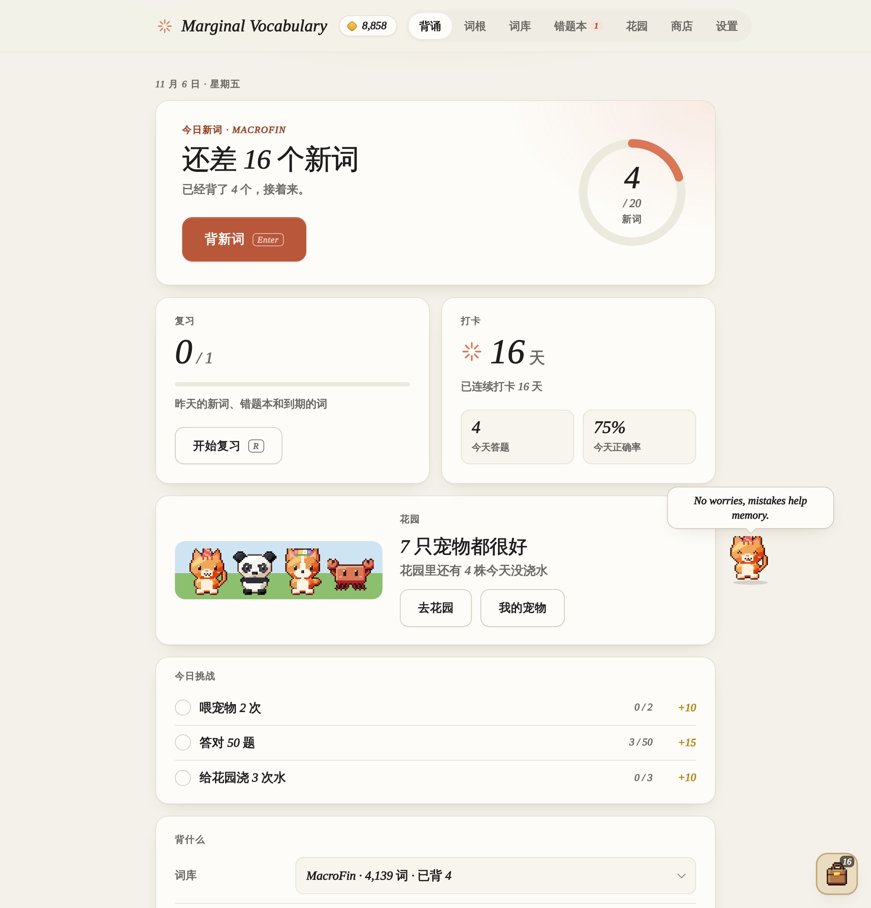
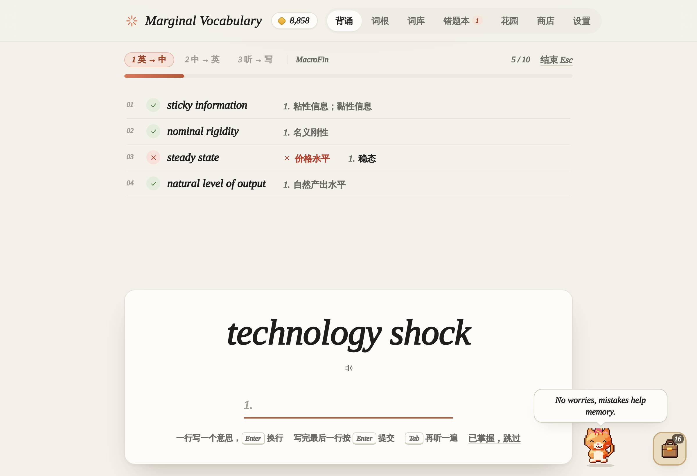

# Marginal Vocabulary

**背单词、学词根的小工具**

[在线使用](https://adrian-z-wong.github.io/Marginal-Vocabulary/Margin.html) · [下载到电脑](https://adrian-z-wong.github.io/Marginal-Vocabulary/) · [反馈问题](https://github.com/Adrian-Z-Wong/Marginal-Vocabulary/issues/new/choose)

## 功能

- 选好词库和每天背多少新词，首页显示今日进度
- 每组三步：看英文写中文 → 看中文拼英文 → 听发音拼英文
- 每日复习：昨天的新词、错题本和按记忆曲线到期的词
- 强制全对（可选）：一组词某一步有错，这一步整组重来，全对才进入下一步
- 词根：按词库学词根词缀，每组三步：看词根选意思 → 看意思选词根 → 在单词里填词根；背单词时显示单词拆解
- 词库：Finance、MacroFin、Medicine、CET-4、CET-6、GEE、TOEFL、IELTS、GRE、GMAT
- 导入自己的词表
- 错题本答对自动移出，已掌握的词不再出现
- 美式 / 英式发音
- 打卡热力图
- 金币和商店：背单词攒金币，买宠物、树和花草的种子、水、肥料、宠物用品、装饰、家具和装扮；每日挑战和成就
- 花园：像星露谷那样的俯视像素农场，有自己的小人和农舍；买种子种下，浇水施肥，从种子长成大树；18 种树、10 种花草、3 种灌木；花园一直留着，可以拉近拉远，可以花金币扩建
- 宠物：21 种宠物和 5 种观赏鱼，同一种可以养好几只；每只都要吃饭、陪它玩，生病了要吃药，不然会死；选一只陪你背单词，它会在页面上走动、用英文说话
- 右下角的背包装着买来的东西
- Mac 应用可以检查更新（菜单 Check for Updates… 或设置里），一键安装，新版本替换旧版本，进度不受影响
- 浅色 / 深色两种外观（米白纸面、陶土色点缀）
- Mac 应用，也可以在线用或下载网页文件，离线可用

## 怎么用

**在线使用**：打开 <https://adrian-z-wong.github.io/Marginal-Vocabulary/Margin.html>。

**下载到电脑**：打开 <https://adrian-z-wong.github.io/Marginal-Vocabulary/>，点「下载到电脑」，再双击下载好的 `Marginal Vocabulary.html`（推荐 Chrome 或 Edge）。

**Mac 应用**：在 [Releases](https://github.com/Adrian-Z-Wong/Marginal-Vocabulary/releases/latest) 下载以 `_aarch64.dmg` 结尾的文件，双击后把 Marginal Vocabulary 拖进「应用程序」。第一次打开如果提示「无法验证开发者」，打开「系统设置 → 隐私与安全性」，点「仍要打开」。适用于 Apple 芯片（M1–M4）的 Mac。

进度保存在浏览器或 App 里。换电脑之前，在「设置」里导出备份。

## 词库

| 词库 | 词数 |
| --- | --- |
| Finance | 18,356 |
| MacroFin | 4,139 |
| Medicine | 24,293 |
| CET-4 | 5,331 |
| CET-6 | 7,086 |
| GEE | 6,511 |
| TOEFL | 6,974 |
| IELTS | 5,040 |
| GRE | 8,806 |
| GMAT | 4,137 |

Finance 收录经济、金融、会计、管理、公司治理、财务管理、资本市场、货币政策等专业词汇。MacroFin 面向宏观经济与金融研究，收录高级宏微观、DSGE 模型与求解估计、宏观金融、货币政策、财政政策、宏观调控、开放经济、计量方法等术语。Medicine 收录解剖、基础医学、内外妇儿各科疾病、临床检查、药理、公共卫生，以及中医理论、经络穴位、中药方剂。CET-4 包含高考词汇，CET-6 和 GEE（考研）包含 CET-4 词汇。原始表格在 [`data/finance/`](data/finance/)、[`data/macrofin/`](data/macrofin/) 和 [`data/medicine/`](data/medicine/)，可以直接用 Excel 打开。

词根板块收录 1208 个前缀、词根、后缀（含医学常用构词成分），以及 1.2 万多个单词的拆解，数据在 [`data/roots/`](data/roots/)。发现不准的地方，欢迎[提 Issue](https://github.com/Adrian-Z-Wong/Marginal-Vocabulary/issues/new/choose)。

## 开发

不依赖任何框架。源码在 `src/`，运行 `python3 tools/build.py` 打包成 `Margin.html`。Mac 应用在 `desktop/`（[Tauri](https://tauri.app)），由 GitHub Actions 自动打包发布。详见 [CONTRIBUTING.md](CONTRIBUTING.md)。

## 致谢

考试词库、音标和中文词向量来自 [ECDICT](https://github.com/skywind3000/ECDICT)（MIT 许可证），详见 [NOTICE.md](NOTICE.md)。发音来自有道词典。

## 许可证

[MIT](LICENSE)
